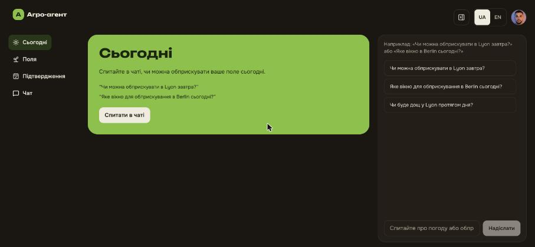
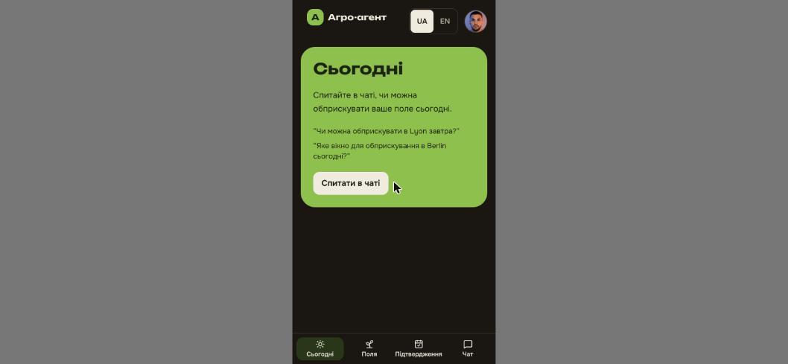
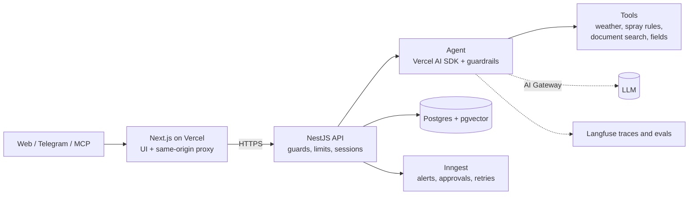

# agri-agent

An AI assistant for farmers and agronomists. It plans field work around the weather, keeps track of fields and what was done on them, answers crop-protection questions with sources, and reaches people where they work: on the web, in Telegram and through morning alerts.

[](https://github.com/hatlesstick/agri-agent/actions/workflows/ci.yml)


**[Open the app](https://agri-agent-m.vercel.app)** · **[API reference](https://vps-32155ccb.vps.ovh.ca/docs)** · [Product scope](docs/product-scope.md) · [Architecture](docs/architecture.md)

## What it does

- **Spray windows.** Hour-by-hour verdicts for a field from the forecast: when it is safe to spray, when to wait, and why.
- **Field memory.** Fields with crop, location and area; questions like "can I spray my wheat field tomorrow?" use them directly.
- **Crop-protection knowledge.** Answers built from curated documents and product labels, always with the source.
- **Approvals.** The assistant prepares changes, such as a new field or a log entry; nothing is saved until a person confirms it.
- **Channels.** Web app, Telegram bot with inline approvals, morning alerts, and an MCP server for other AI clients.
- **Field operations ahead.** Field map, work log with voice input, irrigation and frost alerts, agro models, satellite monitoring and farm teams are on the [roadmap](docs/product-scope.md#backlog-after-the-core).

## Screens

Home screen in the dark theme with the Ukrainian interface, on desktop and on a phone:




## Principles

- **Code decides, the model explains.** Decisions and numbers come from deterministic rules; the model chooses tools and explains the result. When they disagree, the code wins.
- **Human in the loop.** Every write is proposed, approved by a person, then executed and audited.
- **Sources and confidence.** Every answer shows where its data comes from and how fresh it is.
- **Evals first.** Every capability ships with evals that run in CI; real-model runs are compared on quality, cost and latency.

## How it works



One NestJS API owns all backend logic and serves every channel; the web app is UI only. Contracts are shared zod schemas, and the API runs in Docker behind Caddy with automated deploys, database snapshots and rollback. Details: [architecture](docs/architecture.md), [engineering notes](docs/engineering.md), [deploy runbook](docs/deploy.md).

## Tech stack

TypeScript · pnpm + Turborepo · Next.js 16, React 19, Tailwind 4 · NestJS 12 · Vercel AI SDK 7 with AI Gateway · LangChain.js RAG building blocks · Postgres 17 + pgvector, Drizzle · Inngest · Langfuse · Docker Compose, Caddy, GitHub Actions, GHCR · Vitest

## Getting started

Requirements: Node.js 22+, pnpm (corepack), Docker. The scripted mock model needs no API keys.

```bash
corepack enable && pnpm install
cp .env.example .env
cp apps/api/.env.example apps/api/.env          # AI_MOCK=1, Open-Meteo URLs, DATABASE_URL
cp apps/web/.env.example apps/web/.env.local    # API_ORIGIN=http://localhost:4000
pnpm db:up && pnpm --filter @agri/api db:migrate
pnpm dev                                        # web on :3000, API on :4000 (Swagger at /docs)
```

`pnpm test`, `pnpm lint`, `pnpm typecheck` and `pnpm eval` cover the whole repo. All scripts and settings: [engineering notes](docs/engineering.md).

## Repository

```
apps/web          Next.js UI (Vercel)
apps/api          NestJS API: agent, tools, rules, RAG, identity, database (Docker)
packages/shared   zod contracts shared by web and API
infra/            production Compose, Caddy, deploy and server scripts, smoke tests
docs/             scope, architecture, deploy, evals, tech debt
```

## Documentation

| Document | Contents |
|---|---|
| [Product scope](docs/product-scope.md) | Core (Steps 1–5) and backlog |
| [Backlog requirements](docs/backlog-extensions.md) | Extensions E1–E7: user stories, rules, acceptance criteria |
| [Architecture](docs/architecture.md) | System split, AI stack, code rules |
| [Engineering notes](docs/engineering.md) | Decision rules, guardrails, quality gates, configuration, HTTP API |
| [Deploy runbook](docs/deploy.md) | Server setup, deploys, rollback, production checks |
| [Evals](docs/evals.md) · [Model comparison](docs/model-comparison.md) | How the agent is measured and the results per model |
| [Tech debt](docs/tech-debt.md) | Known gaps and when they are paid off |
